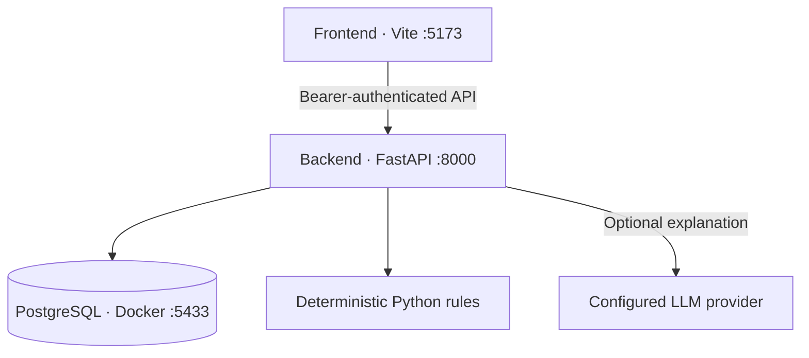

# Architecture

The frontend and backend are ordinary host processes. PostgreSQL is the only Docker Compose service.

## Organizations, sign-in and accounts

The app is multi-organization. A person creates an organization on the sign-in page (`POST /api/auth/signup`) and becomes its `admin`; admins add `member` or `admin` users with a password. A user belongs to exactly one organization and signs in with email and password (`POST /api/auth/login`). Passwords are hashed with scrypt. Sessions are random tokens stored hashed in PostgreSQL, tied to a user, and expire after `SESSION_HOURS`. Wrong passwords are rate-limited per email in memory. There is no email verification, password reset or single sign-on.

**Isolation.** Every tenant table (`resources`, `recommendations`, `cloud_accounts`, `metric_snapshots`, `sync_runs`, `savings_ledger`, `audit_events`, `scans`) carries an `org_id`. After authentication a request's database session is bound to the user's organization (`backend/app/tenant.py`); every query filters by it and new rows are stamped with it on flush, so a row cannot be written without an organization. Resource ids are unique per organization (composite key), the same AWS account may be connected by two organizations, and another organization's id is answered with `404`. The background scheduler syncs each account inside its own organization. `backend/tests/test_tenancy.py` checks isolation across every route.

Each organization has its own cloud provider details: accounts, encrypted credentials, budgets and inventory. The Fernet key (`SECRETS_KEY`) and the optional LLM key are server-wide.

Cloud accounts store an identifier and optional encrypted credentials. Each resource carries an optional `accountId`; the multi-cloud dashboard, comparison and monitor are computed on request from stored inventory. Comparison prices are approximate list prices bundled in `backend/app/insights.py`.

## Collectors, history and the ledger

Emulator modes (`aws_emu`, `azure_emu`) use `collectors/emulator.py` to serve the static data in `emulator_data.py`: a startup fleet with 14 days of generated history, spend by service and an inventory. Only the fake sandbox credentials published in that file are accepted; the live `aws` and `azure` collectors have no special keys. Emulator accounts are labelled Emulator in the UI, and, like demo accounts, reflect implemented changes on the next sync so the savings ledger can verify them.

`backend/app/collectors` holds one collector per cloud: `aws` (boto3), `azure` (REST over httpx) and `demo` (synthetic). Credentials are encrypted with Fernet (`SECRETS_KEY`) in `cloud_accounts.credentials_enc`. `sync.py` runs a collector, ingests the result with material-change detection, records a `sync_runs` row and, in the background, re-syncs due accounts every `SYNC_INTERVAL_MINUTES`. `history.py` turns snapshots into confidence, anomalies and trends. `ledger.py` verifies implemented recommendations on later ingests. See [END_TO_END.md](END_TO_END.md) for the full flow.

## Request flow

1. The Vite dev/preview proxy forwards `/api` to host FastAPI. A deployed static frontend instead needs a reachable API URL or reverse proxy.
2. FastAPI checks the session token, resolves the user's organization and binds the request to it before application access.
3. Pydantic validates normalized input. The backend stores the latest resource snapshot and computes one recommendation per resource.
4. PostgreSQL retains inventory and decisions across browser/backend restarts. The frontend reads authoritative findings; it does not duplicate optimization rules.
5. A decision checks resource generation, recommendation version, current status and action eligibility before committing it with an audit record.

## Tables

| Table | Records |
|---|---|
| resources | Latest normalized snapshot, source and update timestamp |
| recommendations | Finding, status, reviewer label, generation and version |
| scans | Resource/finding counts and scan time |
| audit_events | Persistent action history; UI shows latest 200 |
| organizations | One row per organization: name (unique), creator and timestamps |
| users | Members: email (unique), scrypt password hash, role (`admin`/`member`), organization |
| sessions | Hashed session tokens tied to a user, with expiry |
| metric_snapshots | One reading per resource per sync (CPU, memory, network, cost), kept 90 days. Feeds confidence, anomalies and trends |
| sync_runs | Result of every collector run |
| savings_ledger | Implemented changes and their verification |
| service_costs | Billed cost per cloud service per month for each account (from the provider's cost API); replaced on each sync that reads it |
| cloud_assets | Read-only inventory of resources of any service in an account (EBS, RDS, S3, Lambda and so on); a service the key could not read keeps its previous rows |
| cloud_accounts | Connected AWS/Azure/GCP accounts per organization, with encrypted credentials, mode and budget |

Raw historical time series and detailed billing line items are not stored in this MVP. The spend chart is explicitly illustrative. Add dedicated metrics/billing tables when you integrate actual collectors and want historical charts or measured savings.

## Consistency

All write routes acquire a PostgreSQL transaction-scoped advisory lock keyed by organization, making one organization's imports, scans and decisions serialize across API workers without blocking other organizations. The lock is automatically released on commit or rollback.

Decision versions increase when input or status changes. A UUID generation distinguishes a newly created recommendation from an old recommendation with the same resource ID after deletion/reimport. The frontend must send both values. A stale request returns 409 and the UI refreshes its data.

One finding per resource avoids adding idle, resize and scheduling savings on top of one another. All sample estimates exclude storage, networking, licenses, taxes and commitment effects. The rule priority is telemetry review → idle → rightsizing → schedule → healthy. Rules are candidates for review, not proof of production safety.

## Extension points

- Add Azure/AWS read-only collectors that emit the documented schema.
- Enrich ownership, dependencies, business hours and service criticality before analyzing production workloads.
- Add email verification, password reset and single sign-on, and finer roles, before shared/external deployment.
- Keep any live executor separate from explanations and analytics, with narrowly scoped credentials and durable action jobs.
- Add verified billing baselines and health checks to measure savings after live changes.
- Add an explicit approval callback designed for authenticated owners if you later move approval into a ticketing system.

The source package is independent of the previously published static preview. It is intended to run locally using your requested host-process plus Docker-database setup.
