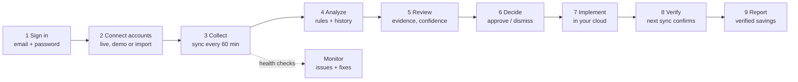
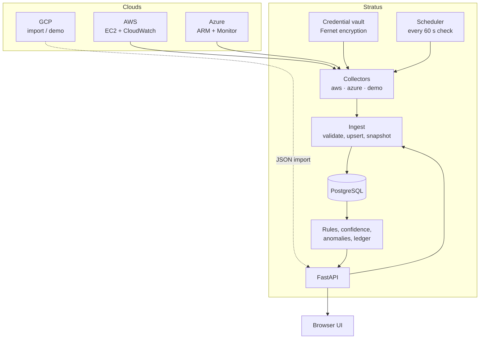

# Stratus: end-to-end flow

Stratus is a workspace where an organization finds wasted cloud spend across AWS, Azure and GCP, decides what to do about it, and then **proves** the savings happened. This document walks through the whole journey, from first setup to a verified result, and explains how each step works inside.

> **Execution is a dry run.** Stratus never stops, resizes or deletes anything in a cloud account. People make changes in their cloud; Stratus recommends, records the decision and later verifies the outcome from collected data.

## 1. Who uses it and why

| Person | What they do in Stratus |
|---|---|
| **Cloud / FinOps lead** | Connects accounts, sets budgets, watches the dashboard and the Savings ledger, prints the executive report |
| **Engineer / service owner** | Reviews recommendations for their VMs, reads the evidence and history, approves or dismisses, marks changes implemented |
| **Leadership** | Reads the one-page report: spend, savings pipeline, health and risks |
| **Organization admin** | Creates the organization, adds and removes members, renames the organization |

Every user belongs to exactly one organization and is either an `admin` or a `member`. Admins can add and remove members and rename the organization; members can do everything else. Every action is attributed to the person's email in the activity log.

## 2. The journey at a glance



| # | Step | Where | What happens |
|---|---|---|---|
| 1 | Sign in | Login screen | Create an organization (you become its admin) or sign in with email and password. A session starts and lasts `SESSION_HOURS` (12 by default) |
| 2 | Connect accounts | **Cloud accounts** | Add an AWS, Azure or GCP account. Choose how data arrives: live read-only collector, demo data, or JSON import. Optionally set a monthly budget |
| 3 | Collect | Background schedule, **Sync now** | The collector reads running VMs and 14 days of metrics, prices them, and stores the result plus a history snapshot |
| 4 | Analyze | Automatic | Rules pick one finding per VM. Confidence is computed from recent readings |
| 5 | Review | **Opportunities** | Each finding shows evidence, a CPU history chart, the cost calculation and a confidence level |
| 6 | Decide | Review drawer | Approve (with a reviewer name), dismiss, or simulate. Stale decisions are rejected |
| 7 | Implement | Your cloud, then **Mark implemented** | A person makes the change. Stratus records who and when, and writes a ledger entry with the baseline cost |
| 8 | Verify | Next sync | If the VM is gone or its monthly cost fell, the saving is **Verified**. After 14 days with no change it is **Not verified** |
| 9 | Report | **Savings**, **Executive report** | The funnel shows Identified → Approved → Implemented → Verified. The report prints to PDF |

### Navigation map

The left menu lists the four product features, plus Organization. Features with two screens are branches that collapse (the app remembers which you closed); the others are single screens. Seven screens in total.

```
Cloud Optimizer             Opportunities · Savings
Multi-cloud Dashboard       Overview · Cloud accounts
Cloud Service Comparison    one screen: sizes, your inventory, pricing models
Troubleshooter / Monitor    one screen: issues and fixes, account health, pipeline
Organization                one screen: settings, members, activity log
```

Where things went: **Approvals** is a status filter on Opportunities. The **Executive report** opens from a button on the dashboard. **Integrations** (JSON import, sample data) lives at the bottom of Cloud accounts. The **Activity log** sits at the bottom of Organization.

On a phone the tree sits behind a **Menu** button.

## 3. How the pieces fit together



* **Every organization is separate.** Each query is scoped to the signed-in user's organization, so accounts, credentials, resources, recommendations, the savings ledger, the audit log, history and budgets never cross organizations.
* **Collectors** read one account each. They are read-only and return the same normalized resource shape as an import.
* **Ingest** is the single door into the database. It validates, upserts, records a history snapshot, re-runs the rules and writes an audit event, all in one transaction.
* **Everything a page shows is computed on request** from stored inventory, snapshots, the ledger and the current settings. There is no separate analytics store to drift out of sync.

## 4. Step by step

### 4.1 Setup (administrator, once)

1. `python scripts/setup.py` creates `.env` with generated secrets, including `SECRETS_KEY` for the credential vault.
2. Set the cloud PostgreSQL `DATABASE_URL` in the root `.env`, then in `backend`: install requirements, `alembic upgrade head`, and start `uvicorn`.
3. In `frontend`: `npm ci` and `npm run dev`.
4. Optionally set in `.env`: `SESSION_HOURS`, `SYNC_INTERVAL_MINUTES`. There is no shared code or admin token; the first user creates an organization on the sign-in page.

**Back up `SECRETS_KEY`.** If it is lost, stored cloud credentials cannot be decrypted and must be entered again.

### 4.2 Sign in

Anyone can create an organization on the sign-in page by giving an organization name, an email and a password of at least 8 characters (`POST /api/auth/signup`); they become its admin. Users then sign in with email and password (`POST /api/auth/login`). Passwords are hashed with scrypt. Five wrong passwords lock that email for ten minutes. Sessions are random tokens stored hashed in the database, tied to a user, and end on **Sign out** or expiry. Data from before multi-organization support was migrated into one organization with no users; signing up with that same organization name claims it, and you become its first admin.

### 4.3 Connect cloud accounts

Open **Cloud accounts → Add cloud account**.

| Method | Use it when | What you provide | What happens |
|---|---|---|---|
| **Live AWS** | You want real EC2 data | 12-digit account ID, access key ID, secret, regions | Credentials are validated, encrypted and stored. Press **Test**, then **Sync now** |
| **Live Azure** | You want real VM data | Subscription ID, tenant ID, client ID, client secret | Same as AWS |
| **Demo data** | Trying the product, demos, training | Nothing | A synthetic fleet with 14 days of history appears immediately. Labelled **Demo** everywhere |
| **Import JSON** | GCP, or any source you collect yourself | Nothing stored | Import a JSON file for that account (**Import JSON** in the UI, `POST /api/inventory`) |

Read-only access required:

* **AWS**: `ec2:DescribeInstances`, `cloudwatch:GetMetricData`, `sts:GetCallerIdentity`. Memory metrics need the CloudWatch agent.
* **Azure**: **Reader** and **Monitoring Reader** on the subscription. Memory metrics need the Azure Monitor Agent.
* **GCP**: no live collector yet. Use demo or import.

**Test** confirms the credentials work and that they belong to the account you entered (an AWS key for a different account is rejected). Credentials are never returned by the API or shown again. **Edit** lets you set a budget or rotate credentials.

### 4.4 Collect

A background task checks every 60 seconds and syncs any demo, AWS or Azure account whose last sync is older than `SYNC_INTERVAL_MINUTES` (60 by default). **Sync now** and **Sync all** run it on demand. Each run is recorded with its result and appears in the account's settings.

What a live collector does:

1. Lists **running** VMs only. A stopped or terminated VM disappears from the inventory, which is how an implemented "stop" is later verified.
2. Reads 14 days of hourly metrics and computes **P95 of the hourly averages** for CPU and memory, and network in MB per day.
3. Reads tags: `Environment`/`env` sets the environment, `Owner`/`Team` the owner, `Critical=true` marks a critical workload, `Name` the display name.
4. Prices the instance from the bundled on-demand price table and sets the rightsizing target to the next smaller size in the same family. Instance types missing from the table are skipped and reported as warnings.
5. **Untagged VMs are treated as Production.** The rules never suggest stopping a production VM, so a missing tag can only make Stratus more cautious.

Re-syncing does **not** erase approvals for routine noise. A decision is only invalidated when the VM's type, cost, environment, owner, name, region, account or criticality changes, or when the recommendation itself changes. Moving P95 CPU from 3.1% to 3.4% keeps the approval.

If a sync fails, the account shows **Sync failed** with a safe error message (credentials are scrubbed), and the Monitor raises a critical issue. The next scheduled run tries again.

### 4.5 Analyze

One finding per VM, in this priority order:

| Finding | Condition | Suggested action |
|---|---|---|
| Review telemetry | Under 14 days of data, under 95% metric coverage, or no memory metric | Collect more data. No savings are claimed |
| Idle resource | CPU under 5%, memory under 15%, network under 1 MB/day, non-production and non-critical | Stop VM. Saving is the full monthly cost |
| Oversized resource | CPU under 30%, memory under 40%, and a cheaper size exists | Resize VM. Saving is the cost difference. Production or critical VMs are marked High risk |
| After-hours usage | Non-critical development VM running over 300 hours a month | Schedule downtime against a 220-hour month |
| Healthy | None of the above | Keep monitoring |

Every sync also stores a **history snapshot** per VM (kept 90 days). Snapshots power three things:

* **Confidence**: how consistently the finding's rule held across the last 14 readings. **High** needs at least 7 readings with at least 90% agreement, **Medium** at least 3 with 70%, otherwise **Low**. It describes evidence stability, not a statistical guarantee.
* **Anomalies** (needs 8 readings): the latest CPU far above the VM's own baseline (more than three standard deviations and at least 15 points), or monthly cost up more than 25%.
* **Trends**: the run-rate chart on the dashboard and the CPU chart in each review drawer.

### 4.6 Review and decide

**Opportunities** lists findings with filters for account, cloud, risk and type. Opening one shows the finding, the evidence grid, the history chart, the cost arithmetic and the confidence. Optional **Ask backend to explain** returns the rule text, or an LLM explanation if one is configured.

Decisions are checked on the server:

| From | Action | To | Rules |
|---|---|---|---|
| Pending | Approve | Approved | Needs positive savings and a reviewer name |
| Pending | Dismiss | Dismissed | |
| Approved | Simulate | Simulated | Dry run only. Nothing is sent to a cloud |
| Approved or Simulated | Mark implemented | Implemented | Creates a ledger entry. Cannot be reopened afterwards |
| Approved, Simulated, Dismissed | Reopen | Pending | |

Each decision carries the version and generation of the recommendation it was based on. If the evidence changed in the meantime the server answers **409** and the page refreshes, so nobody approves a plan based on stale data. Each decision writes an audit event in the same transaction.

### 4.7 Implement and verify

1. Approve the plan.
2. Make the change in the cloud console, Terraform or your normal process. Stratus does not do this for you.
3. Press **Mark implemented**. Stratus records who did it and the baseline monthly cost.
4. On the next sync of that account:
   * VM gone (stopped or terminated): **Verified** for the full baseline cost.
   * VM now at least 2% cheaper (resized): **Verified** for the difference.
   * No cost change after 14 days: **Not verified**.
5. **Savings** shows the pipeline and the ledger. Verified savings are also shown on the dashboard and in the report, with an annualized figure.

Verified means "a later reading shows the cost went down". It is based on on-demand list prices of the collected instance type, not on your invoice.

**In a demo account** the cloud is simulated, so Stratus plays its part: after you press **Mark implemented**, the next sync shows the VM stopped, resized to the next smaller size, or rescheduled, exactly as a real cloud would once you had made the change. That lets you watch a saving go from Implemented to Verified in one sitting.

### 4.8 Monitor and troubleshoot

**Monitor** recomputes health on every request and refreshes itself every 30 seconds. Each issue opens into numbered fix steps.

| Check | Severity |
|---|---|
| Sync failed | Critical |
| Over budget (run rate at or above 100% of the account budget) | Critical |
| Resource under pressure (CPU 95% or memory 95% and above) | Critical |
| Stale data (last report over 72 hours ago) | Critical |
| Approaching budget (90% and above) | Warning |
| Sync overdue (no sync in three intervals) | Warning |
| Resource under pressure (CPU 80% or memory 85% and above) | Warning |
| Unusual CPU, cost jump (anomaly) | Warning |
| Telemetry incomplete (memory missing, coverage under 95%) | Warning |
| Stale data (over 24 hours) | Warning |
| No data received (empty account) | Warning |
| Database unreachable | Critical |
| Short observation window, unassigned resources, no recent analysis | Info |

### 4.9 Budgets

Set a monthly budget per account in **Add** or **Edit**. The accounts table shows the run rate against the budget as a bar that turns amber at 90% and red at 100%, and the Monitor raises the matching issue.

### 4.10 Compare services

**Compare services** prices equivalent sizes (same vCPU and memory) across AWS, Azure and GCP, including Arm options and typical commitment discounts, and lines your own VMs up against the cheapest equivalent. List prices across the big three are usually within a few percent, so the page is honest about it: it shows **About equal** instead of a winner when the spread is under 2%. Prices are approximate US on-demand Linux list prices; moving clouds also adds migration, network and licensing cost.

### 4.11 Ask Stratus

The dashboard has a question box ("Which resources are idle?", "What is wrong right now?", "Which accounts are over budget?"). It is **not an AI model**. A keyword router picks a topic and reads live data, so every number matches a page and can be checked. Unknown questions get a list of supported ones.

### 4.12 Executive report

The **Executive report** button on the dashboard builds a one-page summary for leadership: spend by cloud, the savings pipeline, accounts, top opportunities and open risks. **Print or save as PDF** uses the browser's print dialog with a print-friendly layout.

### 4.13 Organization

**Organization** shows the organization's name and lists its members with their roles, and summarizes the workspace settings (session length, credential encryption, sync schedule, AI status). Admins can rename the organization and add or remove members; when adding a member the admin sets that member's password. The schedule and keys are changed by the server administrator in `.env`.

## 5. Organizations and roles

Stratus is multi-organization. Each organization has its own cloud accounts, credentials, resources, recommendations, savings ledger, audit log, history and budgets, and cannot see another organization's data. The same AWS account ID or resource ID may exist in two organizations without conflict.

| Role | Can do |
|---|---|
| `admin` | Everything a member can, plus add and remove members and rename the organization. The person who creates an organization is its admin |
| `member` | Everything else: connect accounts, review and decide, mark implemented, sync, import, report |

Inventory arrives only through the live read-only AWS and Azure collectors, demo accounts, and JSON import.

## 6. Security and safety model

| Area | How it works |
|---|---|
| Sign-in | Email plus password, hashed with scrypt. Sessions are random tokens stored hashed and tied to a user. Five wrong passwords lock an email for ten minutes (the counter is in memory, per process). There is no email verification, password reset or single sign-on, and sign-up is open to anyone who can reach the API |
| Tenant isolation | Every organization's data is scoped to it in every query. One organization cannot read or change another's. Proven by `backend/tests/test_tenancy.py` |
| Cloud credentials | Encrypted at rest with Fernet using `SECRETS_KEY`. Never returned by the API, never logged. Error messages are scrubbed of credential values before being stored |
| Cloud access | Read-only by design. No collector can change a resource. Execution is a dry run |
| Cautious defaults | Untagged VMs count as Production. Production and critical VMs are never suggested for stopping. Missing telemetry withholds savings |
| Integrity | One writer at a time (database advisory lock). Decisions are version-checked. Imports are validated in full and applied atomically |
| Audit | Every sign-in, sync, import, decision and account change is recorded with the actor's email |
| Limits | 2 MB request bodies, 500 resources per import, 50 accounts |

## 7. Operations

| Task | How |
|---|---|
| Add or remove a member, rename the organization | An admin does it in **Organization**. There is no password reset: an admin sets passwords for the members they add |
| Change sync frequency | `SYNC_INTERVAL_MINUTES` (minimum 5). `SYNC_ENABLED=false` turns the schedule off |
| Rotate cloud credentials | **Cloud accounts → Edit** and enter the new values |
| Remove an account | **Remove**. Deletes its resources and recommendations and erases stored credentials. The audit log is kept |
| Upgrade the database | `python -m alembic upgrade head` from `backend` |
| Back up | Back up the PostgreSQL volume **and** `SECRETS_KEY` |
| Find out why something looks wrong | **Monitor**. Each issue lists the steps to fix it |

## 8. Five-minute demo script

1. **Create an organization** on the sign-in page (name, email, password) or sign in. Point out the organization name, your admin role and the member list.
2. **Cloud accounts → Add**: choose AWS, *Demo data*, set a $2,500 budget. A fleet and 14 days of history appear immediately.
3. **Dashboard**: spend, savings, the by-cloud table and account budgets. Ask *"Which resources are idle?"*.
4. **Opportunities → open an idle VM**: evidence, **High confidence · 14 readings**, history chart, cost arithmetic.
5. **Approve**, then **Mark implemented**. Explain that a person makes the change in the cloud.
6. **Savings**: the pipeline shows the saving as *Implemented*. Back on **Cloud accounts**, press **Sync now**. The VM is gone, and the entry flips to **Verified** with the dollar figure and an annualized total.
7. **Monitor**: an under-pressure production VM, missing memory telemetry, and a budget warning, each with fix steps.
8. **Compare services**, then **Report → Print or save as PDF**.

Be upfront on stage: demo accounts are synthetic (they apply your "implemented" change at the next sync to stand in for the real cloud), live AWS and Azure collectors are read-only and verified against recorded responses in tests rather than a customer account, and execution is a dry run by design.

## 9. Current limits and next steps

* **GCP** has no live collector. Use demo or import.
* **Compute only.** Storage, databases, networking, licenses and commitments are not modelled.
* **List prices, not invoices.** Costs come from an approximate bundled on-demand price table. Verified savings mean "the instance cost fell", not "the bill fell". A billing-export reconciliation is the natural next step.
* **Live collectors were tested with simulated cloud responses**, not against a real customer account. Run **Test** and **Sync now** on a non-production account first.
* **Basic accounts only.** No email verification and no password reset (an admin sets passwords for members they add). Sign-up is open to anyone who can reach the API. Rate limiting is in memory per process. No single sign-on. Add these before wide rollout.
* **Tenant isolation is tested** (`test_tenancy.py`; 58 backend tests pass on in-memory SQLite), and migration 0004 was verified on a clone of a real PostgreSQL database.
* **Dry run.** Adding real execution needs a separately scoped identity, maintenance windows and rollback logic.
* **Ask Stratus** is a keyword router, not a language model. It is deliberately traceable.
